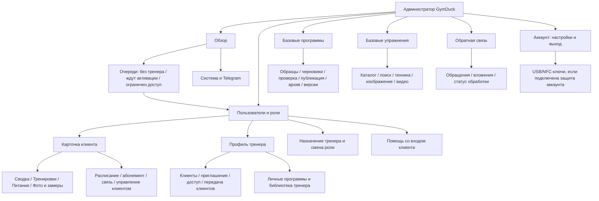

# Карта админки GymDuck

Для знакомства с продуктом и разработки административного интерфейса. Составлено по коду версии **3.0.966**, базовый commit `42e2aa7e`, 17 ноября 2026 года.

Карта описывает существующие экраны, действия и ограничения. Она не подтверждает исправность всех серверных интеграций в конкретном окружении. Проектные правила — [AGENTS.md](../AGENTS.md), запуск на втором компьютере — [codex-team-setup.md](codex-team-setup.md).

## 1. Быстрая карта

На компьютере основные разделы находятся слева. На телефоне нижняя панель содержит те же пять пунктов: **Обзор → Люди → Программы → Упражнения → Обращения**. «Аккаунт» — отдельная кнопка; на компьютере — «Настройки и выход» внизу боковой панели.

## 2. Кто что может

| Роль | Назначение и границы |
| --- | --- |
| Клиент | Собственные тренировки, питание, история, профиль и замеры в пределах выданного доступа. |
| Тренер | Работа с назначенными ему клиентами, их планами и прогрессом; собственные программы и библиотека упражнений. |
| Администратор | Общий каталог пользователей, управление тренерами и назначениями, карточки клиентов, общая базовая библиотека, обращения и служебные инструменты. |

Для настоящего административного доступа нужны актуальные серверные полномочия и административный профиль. Значения `role: "admin"` на клиенте недостаточно. Дополнительно может требоваться подтверждение физическим ключом. В интерфейсе нет выдачи роли администратора обычному пользователю.

## 3. Обзор

| Область | Что показывает / делает |
| --- | --- |
| Счётчики пользователей, клиентов и тренеров | Значения по загруженному административному списку; нажатие открывает нужный фильтр каталога. |
| «Клиенты без тренера» | Очередь клиентов, которым нужно назначение; действие «Назначить». |
| «Ожидают активации» | Ожидающие приглашения тренеров; действие «Проверить». |
| «Ограничен доступ тренеров» | Тренеры с ограничением доступа; действие «Открыть». |
| Быстрые переходы | Открывают основные разделы админки. |
| «Система и Telegram» | Свёрнутые диагностика окружения и обслуживание бота. |

Пустая очередь означает отсутствие соответствующих записей в загруженном списке, а не результат полной диагностики приложения.

## 4. Пользователи и роли

**Путь:** «Пользователи и роли» / «Люди».

Каталог показывает имя, контакты, роль, состояние и назначенного тренера. Для различения похожих аккаунтов используется ID.

| Инструмент | Возможности |
| --- | --- |
| Роль | «Все», «Клиенты», «Тренеры», «Админы». |
| Состояние | «Все состояния», «Активные», «Ожидают», «Доступ ограничен», «Неактивные и архив». |
| Поиск | Имя, логин, email, Telegram или ID; учитываются выбранные фильтры. |
| Карточка клиента | Открывает подробную административную карточку клиента. |
| Карточка тренера | Открывает профиль тренера. |
| Строка администратора | Справочная; текущий каталог не открывает чужую администраторскую карточку. |
| «Пригласить тренера» | Создание тренерского аккаунта и приглашения по имени и логину. |

### Назначение тренера клиенту

**Клиент → «Назначить тренера» / «Изменить тренера» → выбрать тренера → сохранить.**

Сервер обновляет назначение и связанные записи. Прежний тренер теряет прежнюю привязку; клиентские планы и история остаются у клиента. Допустим также тренер с ещё не активированным приглашением. Отозванного, приостановленного, архивного, неактивного или заблокированного тренера выбрать нельзя.

**«Снять назначение»** требует подтверждения. Клиент остаётся без тренера и до нового назначения теряет доступ к тренировкам, питанию и прогрессу. Сохранённые история, питание и замеры не удаляются.

### Смена роли клиента

**Клиент → «Управление ролью» → «Изменить роль на «Тренер»» → подтверждение с именем и ID.**

Меняется роль самого аккаунта; прежнее клиентское назначение снимается. Это не способ назначить клиенту другого тренера.

### Приглашение нового тренера

**«Пригласить тренера» → имя + логин → создать → скопировать ссылку → передать человеку.**

Логин: 3–32 символа, латинские буквы, цифры, `.`, `-`, `_`. Тренер самостоятельно задаёт пароль по ссылке. Автоматической отправки приглашения нет. Создание тренера не назначает ему клиентов.

## 5. Профиль тренера

**Путь:** «Люди» → «Тренеры» → нужный тренер.

| Группа | Действия и результат |
| --- | --- |
| Сведения | Имя, контакты, состояние; назначенные клиенты, программы и упражнения в программах. Неизвестный показатель не равен подтверждённому нулю. |
| Клиенты | Просмотр назначенных клиентов, раскрытие списка, переход в каталог клиентов. |
| «Программы» / «Библиотека» | Открывают рабочие материалы тренера; это отдельная область от общей базовой библиотеки. |
| Приглашение → «Отправить повторно» | Новая ссылка для ожидающего, просроченного или отсутствующего приглашения; старая заменяется. Срок новой ссылки — один час. Активированному тренеру повторное приглашение не создаётся. |
| Приглашение → «Отозвать» | После подтверждения ссылка отменяется, доступ отзывается. Сначала требуется передать назначенных клиентов. Это не удаление аккаунта. |
| Доступ → «Приостановить» | Временное ограничение работы аккаунта с отзывом сессий. Назначенных клиентов сначала нужно переназначить. |
| Доступ → «Вернуть доступ» | Восстановление после приостановки с учётом прежнего состояния; не восстанавливает отозванное приглашение. |
| «Переназначить клиентов» → «Передать клиентов» | Передача выбранному допустимому тренеру. Обычная массовая передача выполняется по одному клиенту; при ошибке возможен частичный результат, который показывает интерфейс. |
| «Передать и снять роль» | Серверная атомарная передача клиентов и перевод прежнего тренера в клиента; предел одной операции — 100 назначенных клиентов. |
| «Снять роль тренера» | Перевод в клиента, закрытие тренерских разделов. Отдельная операция доступна после достоверной проверки отсутствия назначенных клиентов. Программы и история клиентов не удаляются. |

Эти средства не меняют роль или доступ действующего администратора и не выдают роль `admin`. Кнопки удаления тренера в этом профиле нет.

### Материалы тренера

Вход из профиля ведёт в оболочку **«Материалы тренера»**; есть возврат **«К профилю тренера»**.

- **Программы:** поиск, тестовый фильтр, создание шаблона, копирование, удаление, подготовка к назначению; импорт Excel/JSON и ИИ-импорт текста, фото или документа в черновик.
- **Конструктор программы:** месяцы, блоки, недели, тренировки, упражнения и подходы; добавление/копирование/удаление элементов, видео, сохранение шаблона и восстановление несохранённого черновика. Изменение существующего шаблона администратором сохраняет его прежнего владельца.
- **Личная библиотека упражнений:** создание и редактирование карточек, группа мышц, описание/техника, видео и его отображение; работа с удалёнными карточками и восстановлением.
- Связанная карточка упражнения может использоваться в программах; изменение её общих сведений отражается в связанных упражнениях. Нагрузка и история не должны подменяться описанием карточки.

Особенность отбора программ в общем менеджере описана в разделе 13.

## 6. Карточка клиента

**Путь:** «Люди» → «Клиенты» → нужный клиент. Административная оболочка сохраняется, содержимое использует общий модуль работы с клиентом. Администратор может открыть и клиента с незавершённой анкетой; для тренера действует отдельное ограничение.

### Четыре основные вкладки

| Вкладка | Функционал |
| --- | --- |
| «Сводка» | Краткие сведения о клиенте, состоянии программы и активности; переходы к тренировкам, истории и подробностям прогресса. |
| «Тренировки» | План и назначения программ; редактирование дней, упражнений и подходов; добавление, копирование, удаление и перестановка элементов; сохранение. История тренировок и прогресс упражнений открываются отдельными панелями. |
| «Питание» | Аналитика фактического питания, целевые калории и БЖУ, выбор/редактирование и сохранение плана, дневник питания. Средние показатели считаются по завершённым дням без сегодняшнего. |
| «Фото и замеры» | История замеров, динамика и фотографии прогресса. |

В редакторе питания есть **«Сформировать индивидуальный AI-план»**: подготовка черновика по данным клиента. Подготовка не заменяет отдельное сохранение плана.

### Дополнительные панели и действия

| Инструмент | Функционал |
| --- | --- |
| Расписание и абонемент | Даты тренировок, баланс и параметры занятий; сохранение расписания. |
| История тренировок | Сохранённые результаты, поиск/просмотр занятий, более ранние записи при наличии; работа с обратной связью по тренировкам. |
| Прогресс упражнений | Динамика рабочих подходов, фильтры/поиск, история упражнения, разбор ситуации и корректировка нагрузки. Недостаточная история не трактуется как отсутствие прогресса. |
| Назначения программ | Назначить сохранённую программу; администратору также доступны переименование, архивирование, восстановление и удаление назначения через предусмотренные действия. |
| Сообщения и связь | Комментарии клиента, обработка обратной связи, ответ/сообщение клиенту; переход в Telegram при наличии связи. Доставка сообщения — отдельная серверная операция. |
| Напоминания | Настройки напоминаний о тренировках, фото и замерах; подключение Telegram и тестовое уведомление. |
| Данные для входа и связи | Логин, email и Telegram; пароль пользователя не показывается. |
| Задания клиенту | Просмотр заданий и создание нового задания из предусмотренной панели. |

### «Управление клиентом»

| Действие | Что важно |
| --- | --- |
| Открыть/отключить базовые тренировки | Административный доступ к самостоятельным режимам «Сейчас» и «На месяц». Отключение сохраняет историю. |
| Скачать таблицу CSV | Экспорт тренировок, питания и замеров; фактический формат — CSV. |
| Отчёт для печати / PDF | Открытие отчёта для печати или сохранения в PDF средствами браузера. |
| Отметить как тестового / снять отметку | Включение или исключение клиента из общей статистики. |
| Архивировать / восстановить | Изменение доступа и присутствия в активном списке с сохранением истории и программы. |
| Удалить клиента | Только администратор, только клиентский аккаунт, отдельное подтверждение. Текущий обработчик вызывает серверное удаление Auth/Firestore; успех подтверждается ответом сервера. Это не архивирование. |

## 7. Базовые программы

**Путь:** «Базовые программы» / «Программы».

| Элемент | Возможности |
| --- | --- |
| Каталог | Поиск, фильтры «Все», «Опубликованные», «На проверке», «Черновики», «Архив». |
| Системные образцы | Встроенные «Базовый план · Старт» и «Базовый план · Масса». Прямое редактирование образца не предусмотрено: используются «Копировать» / «Создать версию». |
| «Новая программа» | Название, описание, цель, состав тренировок; сохранение черновика. |
| Собственная программа каталога | Изменение, копирование, отправка на проверку, публикация, возврат в черновик, архивирование и восстановление — по допустимому текущему состоянию. |
| История версий | Версия, автор, время, причина и действие; каждое сохранение или переход состояния записывает новую версию. |

Основной цикл: **Черновик → На проверке → Опубликована**. С проверки можно вернуть в черновик. Программу можно архивировать, из архива — восстановить в черновик. Редактирование опубликованной программы сохраняет новую версию как черновик. Уже выданные клиентам планы не переписываются новой публикацией.

Для создания нужны название и хотя бы одна тренировка с упражнением. В новой программе состав вводится построчно, например `День 1: Приседания; Планка`. При редактировании существующего состава или копии доступен расширенный JSON с подробными параметрами. Отправка на проверку и архивирование требуют причины от трёх символов. Жёсткого удаления управляемой базовой программы в этом экране нет.

Счётчики состояний относятся к управляемым программам каталога. Системные образцы показываются отдельно: поэтому «Все» может содержать две карточки при нулевых счётчиках публикаций и черновиков.

Ограничение кнопки «Посмотреть состав» в текущей реализации указано в разделе 13.

## 8. Базовые упражнения

**Путь:** «Базовые упражнения» / «Упражнения».

| Инструмент | Возможности |
| --- | --- |
| Поиск и фильтры | Поиск по каталогу, группа мышц, отбор упражнений без видео или без техники. |
| Редактор карточки | Название, инвентарь, описание техники, изображение и видео; сохранение переопределения базовой карточки. |
| Медиа | Просмотр, загрузка/замена, скрытие («Убрать») и «Вернуть исходное». Скрытие не удаляет сам файл из Storage. |

Группа мышц здесь служит фильтром; отдельного поля её изменения в базовом редакторе нет. Кнопок создания или удаления самого базового упражнения в текущем экране нет. «Убрать» относится к медиа.

Это **общий базовый каталог**, а личная библиотека выбранного тренера — другой раздел. В базовом редакторе нет редактора кадрирования; при замене видео прежние параметры кадрирования и обложки сбрасываются.

Допустимые файлы: изображения JPG/PNG/WebP до 10 МБ, видео MP4/WebM/MOV до 250 МБ. При ошибке загрузки сохранённых переопределений исходный каталог остаётся видимым, а редактирование закрыто до успешного повторного чтения. Изменение общей карточки не переписывает историю и уже выданные планы.

## 9. Обратная связь

**Путь:** «Обратная связь» / «Обращения».

- Читать обращения: автор, дата, контакт, текст, тип и версия приложения при наличии.
- Фильтровать по статусу **«Новые» / «Обработанные» / «Все»** и типу **«Ошибка» / «Отзыв» / «Идея» / «Предложение» / «Все типы»**.
- Обновлять список и загружать следующую страницу. Фильтры применяются к уже загруженным обращениям.
- Смотреть фото в карточке и увеличивать их; скачивать вложения по ограниченной по времени ссылке.
- **«Отметить обработанным» / «Вернуть в новые»** меняют статус обращения.

Изменение статуса не отправляет ответ пользователю. В этом разделе нет формы переписки, автоматического ответа или удаления обращения.

## 10. Telegram и помощь со входом

| Путь | Действие и границы |
| --- | --- |
| Обзор → Система и Telegram → Диагностика подключения | Показывает окружение/проект, ожидаемого бота и сайт. Это сведения конфигурации, а не проверка webhook или доставки. |
| Там же → Обслуживание бота → Переподключить webhook | После отдельного подтверждения меняет серверную конфигурацию webhook. Успешная команда ещё не подтверждает доставку `/start`. Обычная публикация Hosting не требует этой операции. |
| Люди → Помощь со входом клиента → Восстановить вход через Telegram | Выбор существующего активного клиента, ручной ввод Telegram владельца, создание и копирование одноразовой ссылки. |

Ссылка восстановления действует **10 минут**, привязана к ожидаемому владельцу Telegram; выпуск новой отзывает прежнюю. Администратор передаёт ссылку самостоятельно, клиент нажимает Start. UID, назначение тренера и накопленные данные сохраняются. Неактивные, архивные, отозванные, ограниченные и ожидающие назначения аккаунты не являются кандидатами для этого сценария.

## 11. Аккаунт и физические ключи

**Путь:** «Настройки и выход» / «Аккаунт».

Имя и email, переход в личный профиль, выход из текущего аккаунта. При подключённой защите доступен пункт **«USB/NFC-ключи доступа»**.

Менеджер позволяет зарегистрировать первый ключ и включить защиту конкретного аккаунта, добавить резервные ключи и посмотреть их состояние. До пяти ключей; подтверждение входа действует до восьми часов. После истечения требуется новое подтверждение.

Наличие этого кода не означает, что ключ уже зарегистрирован для конкретного production-аккаунта. В интерфейсе нет удаления всех ключей или парольного обхода. Восстановление при потере всех ключей выполняет владелец Firebase-проекта вне приложения. Подробности — [admin-security-keys.md](admin-security-keys.md).

## 12. Что брат сможет проверить локально

Запуск: `npm.cmd run dev:admin`, адрес `http://127.0.0.1:4175/`. Подготовка и обновление — [инструкция](codex-team-setup.md).

| Область | В локальном просмотре 3.0.966 |
| --- | --- |
| Обзор, навигация, каталог, поиск и фильтры | Настоящие компоненты с синтетическими пользователями. |
| Назначение тренера и клиентская/тренерская роль | Ограниченная локальная имитация операций, меняющая только тестовые данные. |
| Профиль тренера | Открывается; часть серверных действий показывает объяснение ограничения. |
| Базовые программы | Реальные редактор и состояния, локальные записи/версии. Перезагрузка страницы сохраняет данные, перезапуск сервера сбрасывает. |
| Базовые упражнения | Реальные каталог/редактор; текстовые переопределения сохраняются локально. Облачная загрузка файлов отключена. |
| Обращения | Настоящий экран с пустым локальным списком; реальные файлы не запрашиваются. |
| Создание приглашённого тренера | Только синтетический аккаунт, без действующей ссылки активации и отправки сообщения. |
| Подробная карточка клиента и материалы тренера | В этом локальном входе не подключены; показывается объяснение. |
| Управление доступом, реальные приглашения, Telegram, физические ключи, авторизация, закрытые видео и файлы | Требуют отдельного согласованного staging-окружения. Локальный вход не выдаёт эти доступы. |

Здесь совпадают компоненты и оформление, но не пользователи и содержимое Production. Старый `?adminHarness=1` остаётся внутренним E2E-инструментом с отдельными демонстрационными экранами; для знакомства с интерфейсом он не подходит.

## 13. Неочевидные особенности текущего кода

1. **«Посмотреть состав» системной программы** сейчас открывает панель истории/сведений о версии. В этой панели не выводится полный перечень тренировок и упражнений. Название кнопки не следует считать подтверждением наличия полного просмотра состава.
2. **Контекст выбранного тренера и менеджер программ:** личные карточки и библиотека отбираются маршрутом по владельцу, но общий менеджер шаблонов получает административный набор `adminTrainingTemplates`. Нельзя предполагать, что весь его список автоматически ограничен выбранным тренером; перед изменением нужно сверять владельца записи.
3. **Наличие обработчика не означает наличие кнопки:** legacy-маршруты и функции переноса аккаунтов, сброса прогресса или дублирования клиента не следует описывать как доступные пункты нового меню без проверки их текущего подключения.
4. **Три разных состояния:** ошибка загрузки, неизвестные сведения и пустой список. Не заменять ошибку или неполные данные «успешным нулём».

Эти пункты зафиксированы для правильного понимания карты; код функций этой документацией не меняется.

## 14. Где искать реализацию

| Область | Исходники |
| --- | --- |
| Общая оболочка и навигация | [AdminWorkspace.jsx](../src/components/admin/AdminWorkspace.jsx), [AppRouter.jsx](../src/app/AppRouter.jsx), [appPages.js](../src/app/appPages.js) |
| Обзор и служебный Telegram | [AdminPanelHub.jsx](../src/components/admin/AdminPanelHub.jsx), [adminAttentionQueue.js](../src/components/admin/adminAttentionQueue.js) |
| Каталог, назначение и приглашение | [AdminUsersWorkspaceRoute.jsx](../src/features/trainer/AdminUsersWorkspaceRoute.jsx), [AdminUsersWorkspace.jsx](../src/components/admin/AdminUsersWorkspace.jsx), [adminOperationalApi.js](../src/features/trainer/adminOperationalApi.js) |
| Профиль тренера | [AdminTrainerProfileRoute.jsx](../src/features/trainer/AdminTrainerProfileRoute.jsx), [AdminTrainerProfile.jsx](../src/components/admin/AdminTrainerProfile.jsx) |
| Карточка клиента | [TrainerUsersRoute.jsx](../src/features/trainer/TrainerUsersRoute.jsx), [AdminClientProfileRoute.jsx](../src/features/trainer/AdminClientProfileRoute.jsx), [TrainerClientsWorkspaceRoute.jsx](../src/features/trainer/TrainerClientsWorkspaceRoute.jsx), [TrainerWorkspace.jsx](../src/components/trainer/TrainerWorkspace.jsx) |
| Действия над клиентом | [TrainerClientActionsSheet.jsx](../src/components/trainer/TrainerClientActionsSheet.jsx), [trainerBridgeHandlers.js](../src/features/trainer/trainerBridgeHandlers.js), [trainerClientActionHandlers.js](../src/features/trainer/trainerClientActionHandlers.js), [trainerAccountAdminHandlers.js](../src/features/trainer/trainerAccountAdminHandlers.js) |
| Материалы тренера | [TrainerAdminWorkoutsRoute.jsx](../src/features/trainer/TrainerAdminWorkoutsRoute.jsx), [TrainerAdminWorkoutsNextRoute.jsx](../src/features/trainer/TrainerAdminWorkoutsNextRoute.jsx), [TrainerProgramManagerView.jsx](../src/features/trainer/TrainerProgramManagerView.jsx) |
| Базовые программы и упражнения | [AdminLibraryRoute.jsx](../src/app/AdminLibraryRoute.jsx), [AdminBaseLibrary.jsx](../src/components/admin/AdminBaseLibrary.jsx), [AdminBasicProgramLifecycle.jsx](../src/components/admin/AdminBasicProgramLifecycle.jsx), [adminBasicProgramLifecycle.js](../src/utils/adminBasicProgramLifecycle.js) |
| Обращения | [AdminFeedbackInbox.jsx](../src/components/admin/AdminFeedbackInbox.jsx), [adminFeedback.js](../functions/adminFeedback.js) |
| Полномочия и сервер | [roleAccess.js](../src/utils/roleAccess.js), [functions/index.js](../functions/index.js), [firestore.rules](../firestore.rules), [storage.rules](../storage.rules) |
| Ключи | [AdminSecurityKeyBoundary.jsx](../src/components/admin/AdminSecurityKeyBoundary.jsx), [adminSecurityKeys.js](../functions/adminSecurityKeys.js), [инструкция](admin-security-keys.md) |
| Локальный просмотр | [dev/admin/main.jsx](../dev/admin/main.jsx), [dev/admin/store.mjs](../dev/admin/store.mjs), [vite.admin-preview.config.js](../vite.admin-preview.config.js) |

Точки входа для проверки UI: [admin-workspace-account.spec.js](../tests/e2e/admin-workspace-account.spec.js), [admin-audit-ux.spec.js](../tests/e2e/admin-audit-ux.spec.js), [локальный просмотр](../tests/local-preview/admin-preview.spec.js). Подходящие проверки и правила изменений — [index.md](../index.md) и [AGENTS.md](../AGENTS.md).
